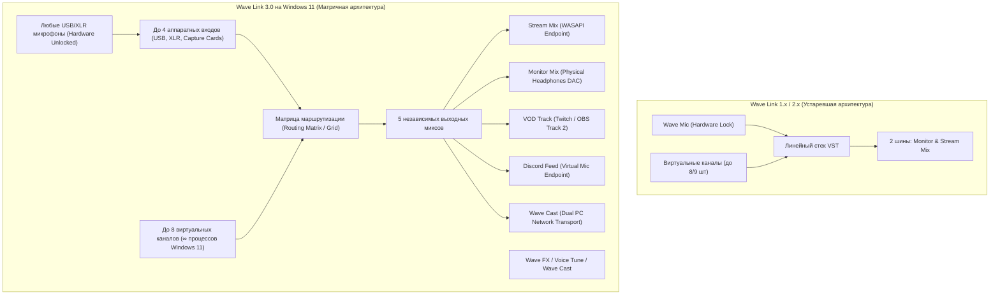
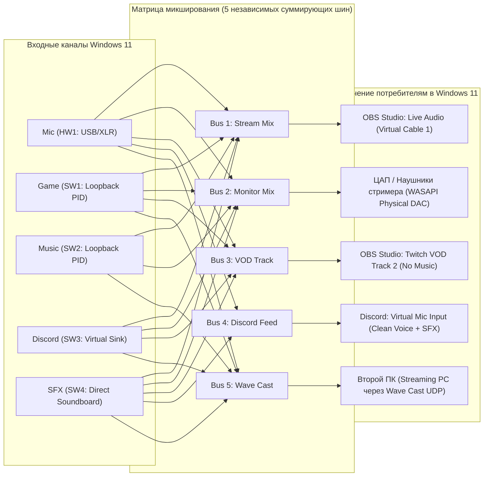

# Архитектурный обзор Elgato Wave Link и ветки Wave Link 3.0 (Windows 11)

## 1. Введение и эволюция Elgato Wave Link

**Elgato Wave Link** — специализированный цифровой аудиомикшер и матричный аудиомаршрутизатор для операционной системы Windows 11, созданный для стримеров, подкастеров, создателей медиаконтента и звукорежиссёров вещания. Исторически Wave Link позиционировался как эксклюзивный программный бонус к микрофонам линейки Wave (Wave:1, Wave:3, Wave XLR). Программный комплекс выполнял ключевую роль: агрегировал аудиопотоки приложений и аппаратных входов, разделял их на два независимых стереомикса (Monitor Mix для наушников создателя и Stream Mix для OBS Studio / трансляции) и интегрировался с элементами управления Windows.

С выходом поколения **Wave Link 3.0** архитектура платформы под Windows 11 претерпела фундаментальный рефакторинг:
- Линейная канальная полоса (Channel Strip) уступила место полноценной **матрице маршрутизации (Routing Table)**.
- Количество виртуальных выходных миксов расширилось с 2 до 5 независимых шин.
- Увеличилось число поддерживаемых физических интерфейсов до 4 аппаратных устройств.
- Появилась группировка произвольного числа процессов ОС внутри одного софтверного канала (до 8 софтверных каналов) на базе современного Windows 11 CoreAudio Process Loopback API.
- Интегрирована новая аппаратно-программная экосистема: **Wave FX Processor**, **Voice Tune**, сетевой аудиомост **Wave Cast** для конфигураций Dual-PC.



---

## 2. Снятие аппаратной привязки (Hardware Unbundling) в Windows 11

### 2.1. Предпосылки и исторический контекст
В версиях Wave Link 1.x–2.x запуск и инициализация аудиодвижка блокировались защитным механизмом лицензирования (Dongle-like hardware locking). Приложение опрашивало USB-шину через WinUSB / HID подсистему Windows, валидируя `Vendor ID` (VID: `0x0fd9` для Elgato Systems GmbH) и `Product ID` (PID):
- Wave:1 (`PID: 0x0068`)
- Wave:3 (`PID: 0x0070`)
- Wave XLR (`PID: 0x0084`)
- Stream Deck + (`PID: 0x0084` / `0x0090`)

Если в системе не обнаруживалось ни одного целевого устройства Elgato, Wave Link блокировал создание виртуальных аудиоустройств и переходил в неактивный режим («Connect a Wave device to unlock Wave Link»). Позже Elgato внедрила временную компромиссную схему: владельцы Stream Deck + могли разблокировать Wave Link без микрофона Wave, однако сторонние микрофоны подключались со значительными ограничениями.

### 2.2. Стратегия полного анлока в Wave Link 3.0
В ветке Wave Link 3.0 компания перешла к стратегии открытого расширения экосистемы:
1. **Бесплатная базовая лицензия для любого железа:** Wave Link 3.0 доступен для свободного скачивания под Windows 11. Он работает с любыми USB-микрофонами (Rode, Shure, Blue Yeti, Audio-Technica), студийными XLR-аудиоинтерфейсами (Focusrite Scarlett, MOTU, Universal Audio Apollo) и встроенными аудиокодеками материнских плат (Realtek ALC1220/ALC4080).
2. **Сепарация уровней Software vs Hardware под Windows 11:**
   - **Software-уровень (доступен всем):** Полноценная матрица маршрутизации, 8 софтверных каналов с группировкой процессов через Windows 11 Process Loopback API, хостинг VST3-плагинов, все 5 выходных шин микширования, WebSocket API для интеграции с внешними клиентами.
   - **Hardware-уровень (аппаратно-специфичные функции Elgato):** Доступен только при наличии фирменных устройств (Wave:3 MK.2, Wave XLR MK.2, Wave Neo, XLR Dock MK.2). Включает в себя:
     - Аппаратную технологию **Clipguard 2.0** (тройной каскад АЦП с динамическим диапазоном 135 дБ).
     - Аппаратный DSP-процессор **Wave FX Processor** (обработка голоса внутри чипа микрофона с околонулевой задержкой < 1 мс).
     - Аппаратный фильтр низких частот (Low-Cut 80/120 Гц).
     - Фирменный алгоритм **Auto Gain Wizard** и прямое управление аналоговым предусилителем микрофона.
     - Управление ёмкостным сенсором Mute и светодиодной кольцевой индикацией.

Такая модель монетизации и удержания пользователей сместила фокус на покупку контента на **Elgato Marketplace** (эффекты, эквалайзеры, профили стримеров), сделав софтверный микшер стандартом де-факто для стриминга на ПК.

---

## 3. Архитектура пользовательского интерфейса: Routing Table и матричная топология

### 3.1. Переход от линейного микшера к матричному виду
Традиционные цифровые микшеры для стриминга используют канальный подход, где на каждый вход выделяется вертикальная полоса с регуляторами (Faders) для Stream и Monitor миксов. При увеличении числа выходов (с 2 до 5) вертикальный интерфейс становится громоздким и трудночитаемым.

В Wave Link 3.0 внедрена **матричная таблица маршрутизации (Routing Table / Routing Matrix)**. Пользовательский интерфейс представлен в виде ортогональной сетки:
- **Строки:** Аудиоисточники (аппаратные входы и софтверные каналы).
- **Столбцы:** Выходные миксы (Stream, Monitor, VOD, Discord, Wave Cast).
- **Узлы пересечения (Crosspoints):** Индивидуальный уровень посыла (Send Gain от `-∞ dB` до `+12 dB`), переключатель Mute, статус пред/пост-фейдерного посыла (Pre/Post-Fader Send).

```
+------------------------+------------+-------------+-----------+--------------+-----------+
| Аудиоисточник (Source) | Stream Mix | Monitor Mix | VOD Track | Discord Feed | Wave Cast |
+========================+============+=============+===========+==============+===========+
| [HW1] Shure SM7B (Mic) |   0.0 dB   |   -6.0 dB   |   0.0 dB  |    0.0 dB    |   0.0 dB  |
| [HW2] Discord Guests   |  -3.0 dB   |    0.0 dB   |  -3.0 dB  |    MUTE      |  -3.0 dB  |
| [SW1] Game (Cyberpunk) |  -10.0 dB  |   -2.0 dB   | -10.0 dB  |    MUTE      |  -10.0 dB |
| [SW2] Spotify (Music)  |  -14.0 dB  |   -8.0 dB   |   MUTE    |    MUTE      |  -14.0 dB |
| [SW3] Browser (Chrome) |  -18.0 dB  |  -12.0 dB   | -18.0 dB  |    MUTE      |  -18.0 dB |
| [SW4] Soundboard (SFX) |   -4.0 dB  |   -4.0 dB   |   -4.0 dB |    -4.0 dB   |   -4.0 dB |
+------------------------+------------+-------------+-----------+--------------+-----------+
```

### 3.2. Разделение входов: Аппаратные входы vs Софтверные каналы

Wave Link 3.0 разделяет входные сущности на два строгих класса:

#### А. Аппаратные входы (Hardware Inputs, до 4 устройств)
- Напрямую захватывают физические звуковые карты, USB-микрофоны, HDMI-карты захвата (Elgato Cam Link, 4K X) через низкоуровневые API Windows (WASAPI Exclusive/Shared с аппаратным буфером).
- Поддерживают установку пред-DSP чувствительности (Input Gain), инверсию фазы, моно-стерео панорамирование.
- Для каждого из 4 аппаратных входов доступен выделенный стек инсерт-эффектов VST3.

#### Б. Софтверные каналы (Software Virtual Channels, до 8 каналов)
- В системе регистрируются до 8 виртуальных конечных аудиоточек рендеринга (Virtual Audio Endpoints).
- Пользователь может группировать **неограниченное количество исполняемых процессов (PID)** внутри одного софтверного канала. Например:
  - Канал «Game»: `cyberpunk2077.exe`, `cs2.exe`, `steam.exe`, `dota2.exe`.
  - Канал «Music»: `spotify.exe`, `tidal.exe`, `foobar2000.exe`, `musicbee.exe`.
  - Канал «Chat»: `discord.exe`, `telegram.exe`, `slack.exe`, `teams.exe`.
  - Канал «Browser»: `chrome.exe`, `firefox.exe`, `edge.exe`.
- Для захвата процессов в Windows 11 используется нативный высокопроизводительный механизм **Application Loopback Capture (`ActivateAudioInterfaceAsync`)** без необходимости ручного переключения устройств вывода в панели управления Windows (`Параметры -> Звук -> Громкость приложений`).

---

## 4. Выходные миксы: Расширение с 2 до 5 независимых шин

В предыдущих поколениях поддерживалось только 2 шины:
1. **Monitor Mix** — персональный мониторинг в наушники стримера.
2. **Stream Mix** — суммарный микс, транслируемый в эфир.

В Wave Link 3.0 число шин увеличено до **5 полностью независимых стереомиксов**, каждый из которых имеет собственный мастер-фейдер, цепь мастер-эффектов (Master Bus VST3) и защитный пиковый лимитер (Output Brickwall Limiter).



### 4.1. Спецификация 5 выходных миксов:

| Микс | Название шины | Типичный потребитель в Windows 11 | Назначение и функциональные особенности |
| :--- | :--- | :--- | :--- |
| **Mix 1** | **Stream Mix** | OBS Studio / Streamlabs / vMix | Главный программный аудиомикс. Содержит голос, игру, музыку, донаты и тиммейтов. Направляется в аудиодорожку прямого эфира. |
| **Mix 2** | **Monitor Mix** | ЦАП / Наушники стримера | Персональный аппаратный микс без задержки. Позволяет стримеру слышать себя, игру и тиммейтов с комфортными персональными балансами. |
| **Mix 3** | **VOD Track** | Twitch VOD / YouTube Audio Track | Специализированный трек для записи архивных трансляций в OBS. В этот микс транслируются игра, голос и эффекты, но **полностью глушится (Mute) музыка**, защищённая авторским правом (DMCA-Safe Track). |
| **Mix 4** | **Discord Feed** | Виртуальный микрофон для голосовых чатов | Чистый поток для собеседников в Discord/Telegram. Включает микрофон стримера и саундборд, но автоматически исключает голоса самих собеседников (Mix-Minus) и звук игры/музыки. |
| **Mix 5** | **Wave Cast** | Второй компьютер (Dual PC Setup) | Сжатый или PCM-поток с ультранизкой задержкой, транслируемый по локальной сети на второй ПК через UDP/QUIC без внешних микшеров и кабелей. |

---

## 5. Поддерживаемые функции расширенной экосистемы

### 5.1. Wave Cast: Сетевой аудиомост для конфигураций Dual-PC
Традиционная передача звука между игровым (Gaming PC) и вещательным (Streaming PC) компьютерами на Windows требовала сложной коммутации:
- Внешние звуковые карты с оптическим интерфейсом S/PDIF TOSLink.
- Аппаратные изоляторы заземления (Ground Loop Isolator) для устранения сетевого гула 50/60 Гц.
- Кабели 3.5 мм Line-Out -> Line-In с неизбежными аналоговыми потерями и джиттером.

**Wave Cast** представляет собой специализированный протокол сетевой передачи звука:
- **Транспорт:** Проприетарный протокол поверх UDP с FEC (Forward Error Correction) и динамическим адаптивным джиттер-буфером под Windows.
- **Формат:** 48 кГц, 24-bit PCM или сжатие с субмиллисекундной задержкой через Opus (при битрейте 256–512 кбит/с).
- **Сквозная задержка (Latency):** Менее 5 мс по гигабитной локальной сети Ethernet.
- **Обнаружение узлов:** mDNS / WS-Discovery автоматическое обнаружение Wave Link инстанса на втором ПК с Windows 11.

### 5.2. Wave FX Processor: Аппаратно-ускоренный DSP
Для совместимых аппаратных устройств Elgato (Wave:3 MK.2, Wave XLR MK.2, Wave XLR Pro, XLR Dock MK.2) обработка звука выполняется на выделенном специализированном сигнальном процессоре (DSP), разработанном в сотрудничестве с австрийской акустической лабораторией **LEWITT Audio**.

Преимущества Wave FX:
- **Нулевая задержка (Zero Host Latency):** Аудиопоток не передаётся в CPU хоста для первичной фильтрации, а обрабатывается аппаратно до USB-контроллера.
- **Консистентность звука:** Обработанный сигнал поступает во все приложения Windows 11 (включая соревновательные игры с античитами Vanguard / EasyAntiCheat, где сторонние виртуальные драйверы иногда вызывают конфликт).
- **Встроенный стек DSP-модулей:**
  1. *Low-Cut Filter* (Hi-Pass): срезает структурные вибрации стола и вентиляторов на 80 Гц / 120 Гц со спадом 18 дБ/октава.
  2. *Expander / Noise Gate*: плавное снижение фонового шума в паузах речи без эффекта резкого обрезания первых согласных (Soft Knee Attack).
  3. *Voice Tune*: формантная коррекция и гармоническое обогащение.
  4. *Compressor*: выравнивание динамического диапазона (RMS-детектор с оптической эмуляцией).
  5. *Parametric Equalizer*: 3-полосный тональный корректор.

### 5.3. Voice Tune: Продвинутое формантное моделирование голоса
**Voice Tune** — интеллектуальный алгоритм коррекции тембра, оптимизированный для разговорного дикторского голоса:
- **Формантный баланс (Formant Preservation & Shift):** Подчёркивает грудной регистр (100–250 Гц) и разборчивость дикции (2.5–4.5 кГц), компенсируя эффект близости (Proximity Effect) или работу микрофона в акустически неподготовленной комнате.
- **Управление одним макро-регулятором:** Пользователь настраивает процент применения (0% — байпас, 100% — плотный радийный вещательный тембр), в то время как движок внутри динамически адаптирует добротность фильтров (Q-factor) и динамическую эквализацию под спектральный состав входящего сигнала.
- **Синхронизация:** Параметры Voice Tune сохраняются в энергонезависимой памяти (EEPROM) Wave XLR / Wave:3 и работают даже при закрытом приложении Wave Link в Windows 11.

---

## 6. Выводы для проекта OpenWaveLink (Windows 11)

Анализ эволюции Elgato Wave Link 3.0 задаёт ключевые требования к открытому аналогу **OpenWaveLink под Windows 11**:
1. Отказ от привязки к конкретному оборудованию — OpenWaveLink полностью бесплатен и открыт для любых USB/XLR микрофонов под Windows 11.
2. Архитектура виртуального микшера должна базироваться на **полноценной матрице маршрутизации $N \times M$**, где $N$ — произвольное число аппаратных и программных входов, а $M$ — произвольное число выходных шин.
3. Прямой захват отдельных процессов через нативный Windows 11 **Process Loopback API** исключает необходимость в ручной перенастройке стандартных устройств вывода ОС.
4. Программный DSP-конвейер OpenWaveLink предоставит софтверную замену аппаратному комплексу Wave FX и Clipguard 2.0 с динамическим диапазоном 32-bit float и двухстадийным лимитированием.
