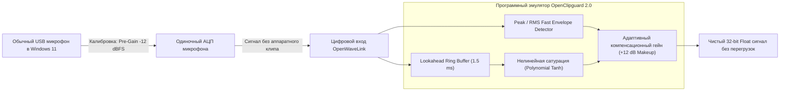
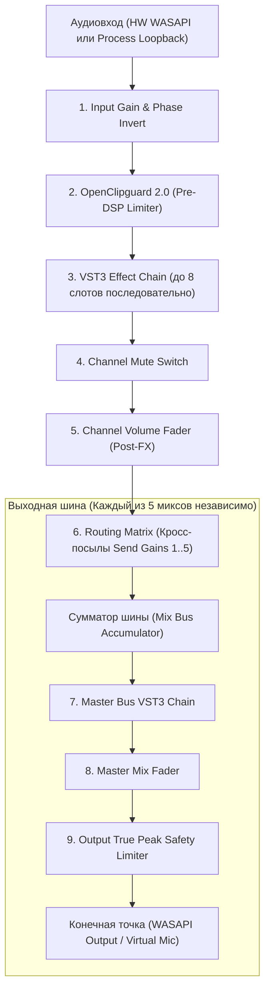

# Архитектура сигнального тракта, Clipguard 2.0 и хостинга VST3 в Windows 11

## 1. Введение: Анатомия цифровой перегрузки

В цифровой обработке звука (DSP) клиппинг (Clipping) возникает в момент, когда амплитуда аналогового входного сигнала превышает максимально допустимый уровень напряжения аналогово-цифрового преобразователя (АЦП), соответствующий значению $0\text{ dBFS}$ (Decibels relative to Full Scale). 

В классических 16- и 24-битных целочисленных системах (Fixed-point PCM) любое превышение диапазона приводит к жёсткому ограничению формы волны (Hard Clipping). Вершины синусоиды срезаются в прямоугольные импульсы, что порождает паразитные гармоники нечётных порядков и резкий интермодуляционный диссонанс, делающий голос неразборчивым и неприятным для восприятия.

В вещании и стриминге под Windows 11 проблема усугубляется:
- Стример может говорить тихо (шепот при чтении чата на уровне $-30\text{ dBFS}$), а через секунду эмоционально закричать от испуга или победы (уровень $+12\text{ dB}$ выше порога АЦП).
- Обычные программные лимитеры не спасают, если сигнал **уже был искажён на стадии аналого-цифрового преобразования** в физическом микрофоне.

---

## 2. Эволюция Clipguard: Версия 1.0 против Версии 2.0

### 2.1. Clipguard 1.0 (Аналоговая двухпутевая коммутация)
Технология Clipguard 1.0, дебютировавшая в микрофонах Elgato Wave:1 и Wave:3, использовала схему с двумя параллельными аналоговыми трактами:
1. **Основной тракт (Main Path):** Сигнал с микрофонного капсюля проходит через предварительный усилитель с выбранным пользователем гейном и поступает на АЦП.
2. **Вторичный аттенюированный тракт (Secondary Path):** Параллельный аналоговый тракт с постоянным аттенюатором (Pad) $-20\text{ dB}$.
3. **Аналоговый компаратор и кроссфейдер:** Аппаратная логика непрерывно отслеживала пики основного тракта. Если амплитуда приближалась к $-3\text{ dBFS}$, схема выполняла переключение на вторичный тракт, цифровой движок компенсировал уровень на $+20\text{ dB}$, маскируя пик.

**Ограничения Clipguard 1.0:**
- При резких транзиентах (взрывные согласные «Б», «П») возникали микронные задержки срабатывания аналогового ключа.
- Фазовые сдвиги между двумя трактами приводили к едва заметной гребенчатой фильтрации (Comb filtering) в момент переключения.
- Динамический диапазон был ограничен возможностями одного 24-битного АЦП (~115–120 дБ).

```mermaid
graph TD
    subgraph Clipguard_1["Clipguard 1.0 (Dual-Path Switched Architecture)"]
        CAP1["Капсюль"] --> PRE1["Предусилитель"]
        PRE1 --> SPLIT1["Сплиттер"]
        SPLIT1 -->|Main 0 dB| ADC_MAIN["Основной АЦП 24-bit"]
        SPLIT1 -->|Pad -20 dB| ADC_PAD["Резервный АЦП 24-bit (-20 dB)"]
        ADC_MAIN --> DETECT["Детектор перегрузки (> -3 dBFS)"]
        DETECT -->|Триггер переключения| SWITCH["Цифровой коммутатор"]
        ADC_PAD -->|Компенсация +20 dB| SWITCH
        SWITCH --> OUT1["Выходной поток 24-bit"]
    end

    subgraph Clipguard_2["Clipguard 2.0 (Stacked ADCs + 32-bit Float Pipeline)"]
        CAP2["Капсюль / XLR"] --> PRE2["Ступенчатый аналоговый фронтенд"]
        PRE2 --> ADC_HIGH["ADC 1: High Sensitivity (Тихие детали)"]
        PRE2 --> ADC_MID["ADC 2: Mid Sensitivity (Номинальная речь)"]
        PRE2 --> ADC_LOW["ADC 3: Low Sensitivity (Экстремальные пики)"]
        ADC_HIGH & ADC_MID & ADC_LOW --> DSP_MERGE["Аппаратный DSP: Stacked Fusion Engine"]
        DSP_MERGE --> FLOAT32["32-bit Float Audio Stream (135 dB Dynamic Range)"]
        FLOAT32 --> PRE_LIM["Lookahead Soft-Knee Limiter (Pre-DSP)"]
        PRE_LIM --> VST_CHAIN["Windows 11 VST3 Processing Chain"]
        VST_CHAIN --> POST_LIM["Master Safety Limiter (Post-Mix)"]
    end
```



### 2.2. Clipguard 2.0 (Архитектура Stacked ADCs)
В поколении устройств с процессором **Wave FX Processor** (Wave XLR MK.2, Wave:3 MK.2, XLR Dock MK.2) Elgato и LEWITT Audio внедрили принципиально новую концепцию **Stacked ADCs (многокаскадные параллельные АЦП)**:
- **Три независимых АЦП работают синхронно:**
  1. *High-Gain ADC:* Оцифровывает тихие звуки (шепот, затухание реверберации) с максимальным соотношением сигнал/шум.
  2. *Mid-Gain ADC:* Оцифровывает рабочий диапазон разговорной речи.
  3. *Low-Gain ADC:* Имеет глубокий аппаратный аттенюатор и оцифровывает пиковые перегрузки вплоть до уровней концертных криков без насыщения аналоговой части.
- **Непрерывное слияние потоков (Continuous Mathematical Fusion):**
  Вместо грубого релейного переключения аппаратный DSP в микрофоне производит непрерывное взвешенное суммирование данных всех трёх преобразователей на базе весовых сплайн-функций.
- **Динамический диапазон 135 дБ:**
  Итоговый динамический диапазон составляет **135 дБ** (от эквивалентного шума входа $-130\text{ dBV}$ до максимального входного уровня $+6\text{ dBV}$). Это физически перекрывает динамический диапазон человеческого слуха (от $0\text{ dBSPL}$ до болевого порога $130\text{ dBSPL}$), делая аппаратный клиппинг невозможным при любых реальных сценариях вещания.

---

## 3. Математика и физика 32-bit Float Audio Pipeline

### 3.1. Формат представления IEEE 754 Single Precision
Внутренний движок микширования Wave Link и разрабатываемый OpenWaveLink под Windows 11 оперируют исключительно форматом **32-bit IEEE 754 Floating Point**:

$$\text{Value} = (-1)^s \times 2^{e - 127} \times \left(1 + \sum_{i=1}^{23} b_{23-i} 2^{-i}\right)$$

Где:
- $s$ — знаковый бит (1 бит);
- $e$ — смещённый порядок (экспонента, 8 бит, диапазон $-126 \dots +127$);
- $b$ — мантисса (23 бита, обеспечивающая 24 бита точности квантования).

### 3.2. Сравнение динамического диапазона форматов

| Формат данных | Разрядность сетки | Теоретический динамический диапазон | Максимальное значение до клиппинга |
| :--- | :--- | :--- | :--- |
| **16-bit Integer** | Целые числа $[-32768, 32767]$ | $\approx 96.3\text{ dB}$ ($6.02 \times 16$) | $0\text{ dBFS}$ (значение $\pm 32767$) |
| **24-bit Integer** | Целые числа $[-8388608, 8388607]$ | $\approx 144.5\text{ dB}$ ($6.02 \times 24$) | $0\text{ dBFS}$ (значение $\pm 8388607$) |
| **32-bit Float** | Мантисса 24 бит + Экспонента 8 бит | **$\approx 1528\text{ dB}$** | **$+770\text{ dBFS}$** (значение $\approx 3.4 \times 10^{38}$) |

### 3.3. Почему 32-bit float даёт бесконечный Headroom внутри микшера
В целочисленном микшере (24-bit Fixed point), если два входных канала имеют уровень $0\text{ dBFS}$ и суммируются, результат равен $+6.02\text{ dBFS}$. В фиксированной точке значение сэмпла мгновенно обрезается до потолка $1.0$, и информация навсегда теряется. Даже если на мастер-шине убавить громкость на $-10\text{ dB}$, сигнал останется срезанным.

В **32-bit Float**:
- Значение $1.0$ соответствует номинальному $0\text{ dBFS}$.
- Сигнал с амплитудой $+24\text{ dBFS}$ имеет числовое значение $15.84$. Компьютер хранит это число с абсолютной точностью, просто увеличивая экспоненту $e$.
- Если после цепочки перегруженных плагинов или суммирования 8 каналов на мастер-шине применить фейдер $-24\text{ dB}$, форма волны вернётся в диапазон $[-1.0, +1.0]$ **без потери единого бита информации и без малейших искажений**.

---

## 4. Двухстадийный лимитер: Pre-DSP и Output Master Limiter

Хотя внутри 32-bit float движка клиппинг невозможен, он неизбежен в двух внешних точках:
1. На входе VST3-плагинов: многие аналого-моделирующие плагины (эмуляции компрессоров LA-2A, 1176, дисторшн) рассчитаны на уровни около $0\text{ dBFS}$ и начинают непредсказуемо искажать звук при поступлении сигналов $+12\text{ dBFS}$.
2. На выходе из микшера в физический ЦАП или вещательный энкодер (OBS Studio, Twitch), где поток конвертируется обратно в 24-bit PCM или 16-bit PCM.

Поэтому Wave Link 3.0 и OpenWaveLink применяют **двухстадийное лимитирование**.

### 4.1. Стадия 1: Pre-DSP Lookahead Soft-Knee Limiter
Устанавливается сразу после захвата микрофона перед цепочкой VST3:
- **Lookahead-буфер ($T_{la}$):** Аудиопоток задерживается на фиксированное время (1.5–3.0 мс / 64–128 сэмплов). Это позволяет лимитеру «заглянуть в будущее» и начать плавное снижение усиления (Gain Reduction) за доли миллисекунды **до** физического прихода транзиента, гарантируя отсутствие выбросов (Zero Overshoot).
- **Плавное колено (Soft Knee):** Вместо резкого излома передаточной характеристики используется квадратичный сплайн в зоне колена шириной $W$ дБ вокруг порога $T$ дБ:

$$f(x) = \begin{cases} 
x, & x < T - \frac{W}{2} \\
x - \frac{\left(x - T + \frac{W}{2}\right)^2}{2W}, & \left|x - T\right| \le \frac{W}{2} \\
T, & x > T + \frac{W}{2}
\end{cases}$$

- **Адаптивное время восстановления (Adaptive Release):** Время возврата усиления динамически варьируется от $20\text{ мс}$ для коротких щелчков до $200\text{ мс}$ для протяжных гласных звуков во избежание эффекта «накачки» (Pumping Artifacts).

### 4.2. Стадия 2: Output Master Brickwall Safety Limiter
Устанавливается на каждой из 5 выходных шин микширования (Stream, Monitor, VOD, Discord, Wave Cast):
- Работает в режиме строгого кирпичного ограничения (True Peak Brickwall).
- Включает 4-кратную передискретизацию (4x Oversampling) для детекции межсэмпловых пиков (Inter-Sample Peaks, ISP). При сжатии звука в lossy-кодеки (Opus/AAC в OBS) сигналы с пиками в $-0.1\text{ dBFS}$ могут реконструироваться в аналоговом тракте зрителя с уровнем $+1.5\text{ dB}$, вызывая слышимый хрип ЦАП смартфона. Мастер-лимитер удерживает потолок строго на уровне $-1.0\text{ dBTP}$ (True Peak).

---

## 5. Рецепт софтверной эмуляции Clipguard 2.0 для OpenWaveLink

Поскольку у большинства пользователей в Windows 11 подключены стандартные микрофоны (Blue Yeti, Shure MV7, Rode PodMic USB, Focusrite Scarlett Solo) с обычным одиночным 16/24-битным АЦП, OpenWaveLink предлагает инновационный **программный комплекс эмуляции Clipguard**:



### Алгоритм софтверного Clipguard 2.0:
1. **Инструкция калибровки аналогового входа:** OpenWaveLink через мастер настройки рекомендует пользователю выставить аппаратную чувствительность микрофона в Windows 11 так, чтобы обычная громкая речь находилась в районе $-18 \dots -12\text{ dBFS}$. Это резервирует **$12\text{ дБ}$ аппаратного запаса (Headroom)** в самом АЦП на случай крика.
2. **Цифровой предиктивный компенсатор:** Внутри движка OpenWaveLink тихий сигнал автоматически поднимается на $+12\text{ dB}$ (Makeup Gain) до вещательного стандарта.
3. **Плавная полиномиальная сатурация (Soft Saturation Curve):** При приближении пика к порогу $-1.5\text{ dBFS}$ включается сглаживающая функция на базе гиперболического тангенса:

$$y[n] = \begin{cases}
x[n], & |x[n]| < x_{thresh} \\
\operatorname{sgn}(x[n]) \cdot \left(x_{thresh} + (1 - x_{thresh}) \tanh\left(\frac{|x[n]| - x_{thresh}}{1 - x_{thresh}}\right)\right), & |x[n]| \ge x_{thresh}
\end{cases}$$

Это обеспечивает музыкальное, тёплое ограничение аналогового типа без клиппинга даже при экстремальных звуковых ударах.

### Реализация эмулятора на C++ (Windows 11):
```cpp
#include <cmath>
#include <algorithm>
#include <vector>

class OpenClipguardEmulator {
public:
    OpenClipguardEmulator(float sampleRate, float lookaheadMs = 2.0f) 
        : sample_rate_(sampleRate), threshold_(0.85f) // ~ -1.4 dBFS
    {
        lookahead_samples_ = static_cast<size_t>(sampleRate * (lookaheadMs / 1000.0f));
        delay_buffer_.resize(lookahead_samples_, 0.0f);
        write_pos_ = 0;
    }

    void ProcessBlock(float* samples, size_t count) {
        for (size_t i = 0; i < count; ++i) {
            float in_sample = samples[i];
            
            // Запись в кольцевой буфер упреждения
            float delayed_sample = delay_buffer_[write_pos_];
            delay_buffer_[write_pos_] = in_sample;
            write_pos_ = (write_pos_ + 1) % lookahead_samples_;

            // Оценка пика и применение функции насыщения
            float abs_val = std::abs(delayed_sample);
            if (abs_val <= threshold_) {
                samples[i] = delayed_sample;
            } else {
                float sign = (delayed_sample > 0.0f) ? 1.0f : -1.0f;
                float excess = (abs_val - threshold_) / (1.0f - threshold_);
                samples[i] = sign * (threshold_ + (1.0f - threshold_) * std::tanh(excess));
            }
        }
    }

private:
    float sample_rate_;
    float threshold_;
    size_t lookahead_samples_;
    std::vector<float> delay_buffer_;
    size_t write_pos_;
};
```

---

## 6. Хостинг VST3 в Windows 11 и компенсация задержки плагинов (PDC)

### 6.1. Архитектура VST3-хостинга под Windows 11
Формат **Steinberg VST3 (Virtual Studio Technology 3)** является единственным индустриальным стандартом для аудиоплагинов в среде Windows 11:
- Плагины представляют собой нативные 64-битные DLL-библиотеки в директории `C:\Program Files\Common Files\VST3\`.
- **Разделение Controller и Processor:** Интерфейс `Steinberg::Vst::IComponent` отвечает за аудиообработку в реальном времени, а `Steinberg::Vst::IEditController` — за GUI и управление параметрами.
- **Встраивание графического интерфейса в Windows 11:** Интерфейс плагина (`IPlugView`) привязывается напрямую к дескриптору окна Win32 (`HWND`) интерфейса OpenWaveLink через метод `attached(hwnd, kPlatformTypeHWND)`.
- **Обработка буферов:** Выполняется в формате 32-bit Float через метод `IAudioProcessor::process(ProcessData& data)` в высокоприоритетном потоке MMCSS без аллокаций памяти в куче (Zero Heap Allocations in Audio Thread).



### 6.2. Компенсация задержки плагинов (Plugin Delay Compensation, PDC)
Современные плагины подавления шума в Windows 11 (Elgato Noise Removal на базе NVIDIA Maxine, iZotope RX Voice De-noise, neural net Denoisers) требуют оконного преобразования Фурье (FFT) с окнами размером $1024$ или $2048$ сэмплов, что порождает системную задержку (Plugin Latency):
- Если плагин вносит задержку в $1024$ сэмпла ($\approx 21.3\text{ мс}$ при $48\text{ кГц}$), а остальные каналы имеют задержку $0$ сэмплов, то в суммарном миксе звук микрофона отстанет от звука игры или саундборда.
- В VST3 плагин сообщает свою точную задержку хосту через метод `IAudioProcessor::getLatencySamples()`.

#### Алгоритм PDC в OpenWaveLink под Windows 11:
1. При каждом изменении цепочки плагинов или параметров вычисляется общая задержка каждого входного канала:
   $$D_{ch} = \sum_{k=1}^{M} D_{plugin\_k}$$
2. Находится критический путь максимальной задержки во всей системе:
   $$D_{max} = \max_{ch \in Channels} (D_{ch})$$
3. Для каждого канала $ch$ рассчитывается компенсирующая задержка:
   $$\Delta_{ch} = D_{max} - D_{ch}$$
4. На входе каждого канала активируется линия задержки (Circular Delay Line) размером ровно $\Delta_{ch}$ сэмплов.
5. **Результат:** Аудиопотоки всех источников достигают матрицы микширования в **идеальной фазовой синхронности**, полностью устраняя временной джиттер и гребенчатые фильтрации при совместном звучании микрофонов и игрового звука.
