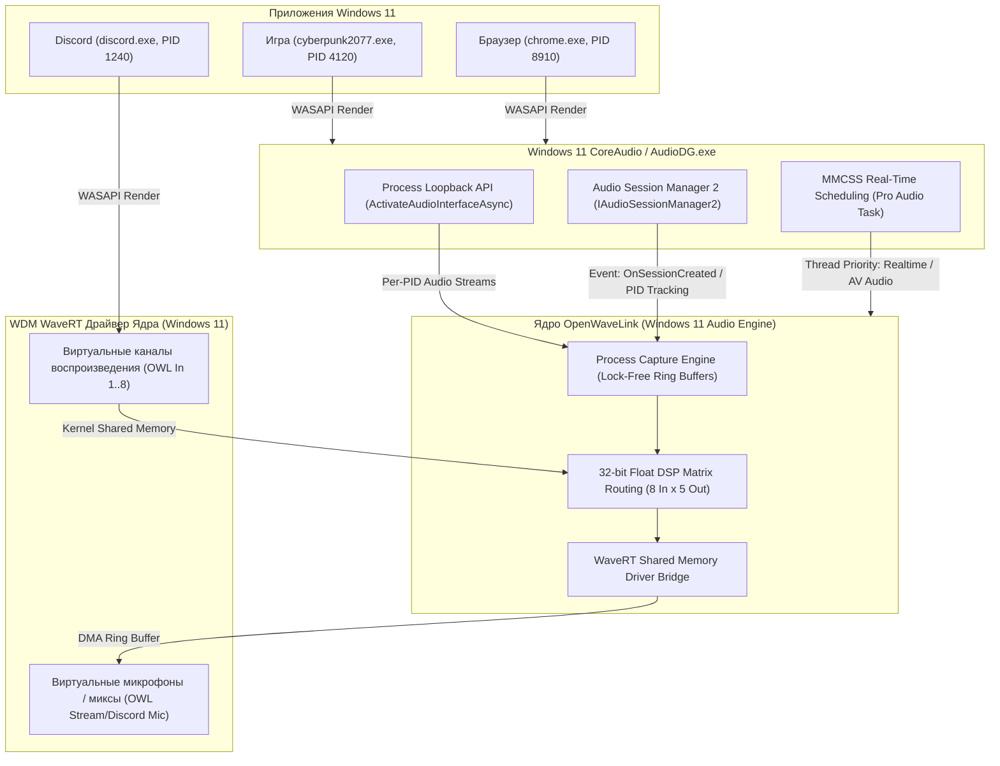
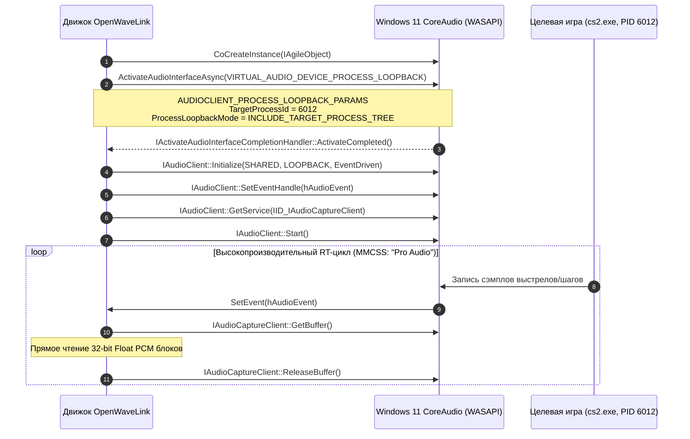
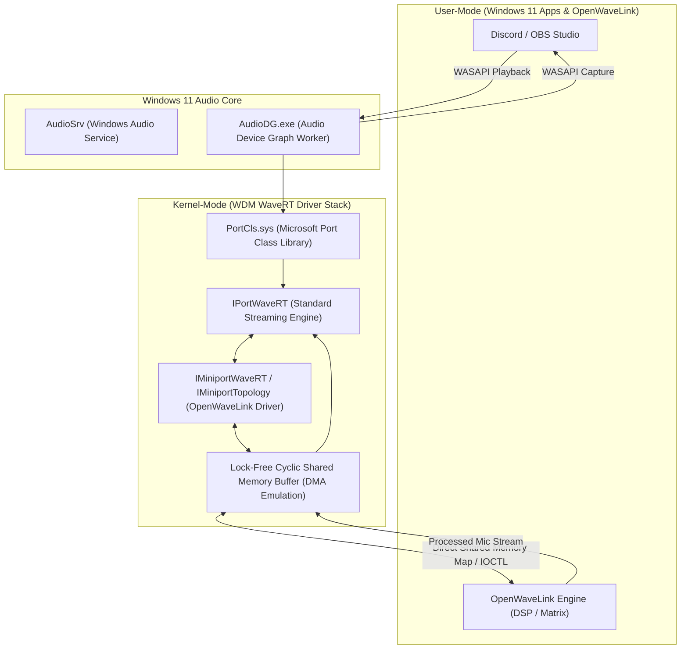
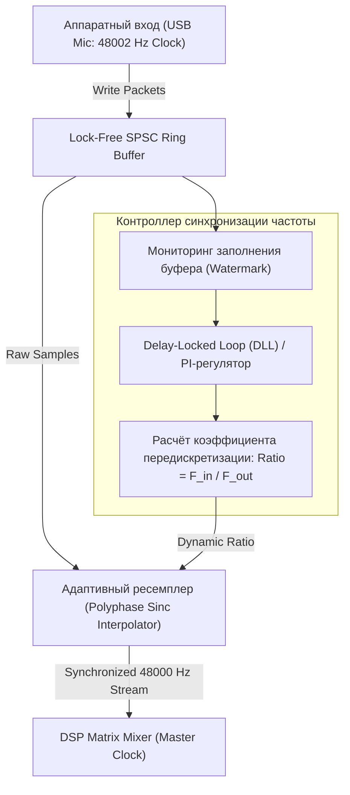

# Архитектура аудиомаршрутизации, виртуальных драйверов и системного захвата в Windows 11

## 1. Введение: Архитектура аудиотракта Windows 11

В операционной системе Windows 11 звуковая подсистема построена вокруг архитектуры **Universal Audio Architecture (UAA)** и сервиса **Windows CoreAudio (WASAPI)**. Базовая модель Windows направляет аудиопоток каждого приложения (Render Stream) в глобальный сессионный микшер `AudioDG.exe` (Audio Device Graph Worker), который суммирует сигналы и отправляет их в физический аудиодрайвер.

Для создания профессионального вещательного микшера класса OpenWaveLink под Windows 11 требуется решение трёх взаимосвязанных инженерных задач:
1. **Изолированный захват отдельных процессов ОС:** Перехват аудиопотока конкретного запущенного процесса (игры, браузера, голосового чата) без смешивания его с глобальным миксом Windows 11.
2. **Виртуальные устройства ядра (WDM WaveRT):** Создание виртуальных аудиоустройств, распознаваемых Windows 11 как стандартные аппаратные динамики (Render Endpoints) и микрофоны (Capture Endpoints) с поддержкой эксклюзивного режима и пространственного звука.
3. **Управление сессиями и планировщиком реального времени:** Мониторинг появления и завершения процессов через `IAudioSessionManager2` и приоритизация аудиопотоков через Windows Multimedia Class Scheduler Service (MMCSS).



---

## 2. Windows 11 CoreAudio: Механизм захвата процессов (Application Loopback API)

### 2.1. Эволюция от классического Loopback к Process-Loopback
В устаревшем WASAPI Loopback (`AUDCLNT_STREAMFLAGS_LOOPBACK`) аудиозахват был привязан к конкретной конечной точке рендеринга (Render Endpoint). Это означало, что перехватить звук игры отдельно от системных уведомлений и музыки было невозможно без создания виртуального физического кабеля в диспетчере устройств.

В **Windows 11** Microsoft внедрила **Application Loopback API**, позволяющий напрямую захватывать аудиопоток конкретного идентификатора процесса (`TargetProcessId`) или всего дерева его дочерних процессов (`PROCESS_LOOPBACK_MODE_INCLUDE_TARGET_PROCESS_TREE`) в пользовательском пространстве без внедрения DLL в память игры.



### 2.2. Архитектура и структуры данных COM-интерфейса

Активация выполняется асинхронно через функцию `ActivateAudioInterfaceAsync` с использованием системного идентификатора псевдоустройства `VIRTUAL_AUDIO_DEVICE_PROCESS_LOOPBACK`:

```cpp
#include <windows.h>
#include <mmdeviceapi.h>
#include <audioclient.h>
#include <audioclientactivationparams.h>
#include <wrl/client.h>
#include <wrl/implements.h>
#include <avrt.h>
#include <iostream>

#pragma comment(lib, "avrt.lib")

using Microsoft::WRL::ComPtr;
using Microsoft::WRL::RuntimeClass;
using Microsoft::WRL::RuntimeClassFlags;
using Microsoft::WRL::ClassicCom;
using Microsoft::WRL::FtmBase;

// Асинхронный Completion Handler для получения интерфейса IAudioClient
class AudioActivationHandler : public RuntimeClass<RuntimeClassFlags<ClassicCom>, 
                                                   IActivateAudioInterfaceCompletionHandler, 
                                                   FtmBase> 
{
public:
    explicit AudioActivationHandler(HANDLE completionEvent) 
        : completion_event_(completionEvent), hr_result_(E_FAIL) {}

    STDMETHOD(ActivateCompleted)(IActivateAudioInterfaceAsyncOperation* asyncOp) override {
        HRESULT hr = S_OK;
        ComPtr<IUnknown> activatedInterface;
        hr = asyncOp->GetActivateResult(&hr_result_, &activatedInterface);
        
        if (SUCCEEDED(hr) && SUCCEEDED(hr_result_)) {
            hr_result_ = activatedInterface.As(&audio_client_);
        }
        
        SetEvent(completion_event_);
        return S_OK;
    }

    HRESULT GetResult(ComPtr<IAudioClient>& client) {
        if (SUCCEEDED(hr_result_)) {
            client = audio_client_;
        }
        return hr_result_;
    }

private:
    HANDLE completion_event_;
    HRESULT hr_result_;
    ComPtr<IAudioClient> audio_client_;
};
```

### 2.3. Инициализация захвата процесса на C++ в Windows 11

```cpp
HRESULT StartProcessAudioCapture(DWORD targetPid, ComPtr<IAudioClient>& outAudioClient, HANDLE& outBufferEvent) {
    HANDLE hComplete = CreateEvent(nullptr, FALSE, FALSE, nullptr);
    if (!hComplete) return HRESULT_FROM_WIN32(GetLastError());

    auto handler = Microsoft::WRL::Make<AudioActivationHandler>(hComplete);

    // Конфигурация структуры параметров для Windows 11
    AUDIOCLIENT_ACTIVATION_PARAMS activationParams = {};
    activationParams.ActivationType = AUDIOCLIENT_ACTIVATION_TYPE_PROCESS_LOOPBACK;
    activationParams.ProcessLoopbackParams.TargetProcessId = targetPid;
    
    // Захватывать целевой процесс И все его дочерние потоки/процессы
    activationParams.ProcessLoopbackParams.ProcessLoopbackMode = 
        PROCESS_LOOPBACK_MODE_INCLUDE_TARGET_PROCESS_TREE;

    PROPVARIANT propVar = {};
    propVar.vt = VT_BLOB;
    propVar.blob.cbSize = sizeof(activationParams);
    propVar.blob.pBlobData = reinterpret_cast<BYTE*>(&activationParams);

    ComPtr<IActivateAudioInterfaceAsyncOperation> asyncOp;
    HRESULT hr = ActivateAudioInterfaceAsync(
        VIRTUAL_AUDIO_DEVICE_PROCESS_LOOPBACK,
        __uuidof(IAudioClient),
        &propVar,
        handler.Get(),
        &asyncOp
    );

    if (FAILED(hr)) {
        CloseHandle(hComplete);
        return hr;
    }

    // Ожидание завершения асинхронной активации COM
    WaitForSingleObject(hComplete, 2000);
    CloseHandle(hComplete);

    hr = handler->GetResult(outAudioClient);
    if (FAILED(hr)) return hr;

    // Чтение нативного формата микшера Windows 11 (32-bit Float, 48 kHz Stereo)
    WAVEFORMATEX* mixFormat = nullptr;
    hr = outAudioClient->GetMixFormat(&mixFormat);
    if (FAILED(hr)) return hr;

    // Создание события для Event-Driven буферизации реального времени
    outBufferEvent = CreateEvent(nullptr, FALSE, FALSE, nullptr);

    const REFERENCE_TIME hnsBufferDuration = 100000; // 10 мс
    hr = outAudioClient->Initialize(
        AUDCLNT_SHAREMODE_SHARED,
        AUDCLNT_STREAMFLAGS_LOOPBACK | AUDCLNT_STREAMFLAGS_EVENTCALLBACK,
        hnsBufferDuration,
        0,
        mixFormat,
        nullptr
    );

    if (SUCCEEDED(hr)) {
        hr = outAudioClient->SetEventHandle(outBufferEvent);
    }

    CoTaskMemFree(mixFormat);
    return hr;
}
```

### 2.4. Поток захвата с приоритизацией MMCSS (Pro Audio)

```cpp
DWORD WINAPI AudioCaptureThread(LPVOID lpParam) {
    auto* capturer = reinterpret_cast<ProcessAudioCaptureContext*>(lpParam);
    
    // Регистрация потока в Windows 11 Multimedia Class Scheduler Service
    DWORD taskIndex = 0;
    HANDLE hMmcss = AvSetMmThreadCharacteristicsW(L"Pro Audio", &taskIndex);
    if (!hMmcss) {
        hMmcss = AvSetMmThreadCharacteristicsW(L"Audio", &taskIndex);
    }

    ComPtr<IAudioCaptureClient> captureClient;
    capturer->audioClient->GetService(IID_PPV_ARGS(&captureClient));
    capturer->audioClient->Start();

    while (capturer->isRunning) {
        DWORD waitResult = WaitForSingleObject(capturer->hBufferEvent, 500);
        if (waitResult != WAIT_OBJECT_0) continue;

        BYTE* pData = nullptr;
        UINT32 framesAvailable = 0;
        DWORD flags = 0;

        while (SUCCEEDED(captureClient->GetBuffer(&pData, &framesAvailable, &flags, nullptr, nullptr))) {
            if (framesAvailable == 0) break;

            if (flags & AUDCLNT_BUFFERFLAGS_SILENT) {
                // Заполнение нулями при паузе в приложении
                capturer->ringBuffer.WriteSilence(framesAvailable);
            } else {
                // Передача 32-bit float сэмплов в кольцевой буфер OpenWaveLink
                auto* floatSamples = reinterpret_cast<const float*>(pData);
                capturer->ringBuffer.Push(floatSamples, framesAvailable * 2); // 2 канала (Stereo)
            }

            captureClient->ReleaseBuffer(framesAvailable);
        }
    }

    capturer->audioClient->Stop();
    if (hMmcss) AvRevertMmThreadCharacteristics(hMmcss);
    return 0;
}
```

---

## 3. Архитектура аудиосессий Windows 11 (Audio Session Management)

Для того чтобы пользовательский интерфейс OpenWaveLink мог автоматически отображать список всех активных программ, извлекать их иконки и автоматически перенаправлять звук при запуске игры, используется подсистема **Windows Audio Session API (WASAPI Audio Sessions)**.

### 3.1. Управление сессиями через IAudioSessionManager2 и IAudioSessionEnumerator
Каждая программа, выводящая звук в Windows 11, регистрирует аудиосессию (`IAudioSessionControl2`):
- `IAudioSessionEnumerator` позволяет перечислить все запущенные программы со звуком.
- `GetProcessId(&pid)` сопоставляет сессию с исполняемым файлом (`.exe`), именем окна и иконкой приложения.
- `IAudioSessionNotification` уведомляет движок OpenWaveLink о запуске новой программы в системе:

```cpp
class AudioSessionNotificationListener : public RuntimeClass<RuntimeClassFlags<ClassicCom>, 
                                                             IAudioSessionNotification>
{
public:
    STDMETHODIMP OnSessionCreated(IAudioSessionControl* newSession) override {
        ComPtr<IAudioSessionControl2> session2;
        if (SUCCEEDED(newSession->QueryInterface(IID_PPV_ARGS(&session2)))) {
            DWORD pid = 0;
            session2->GetProcessId(&pid);
            
            // Если этот PID входит в список правил OpenWaveLink (например, "Game" или "Browser"),
            // автоматически запускаем Process Loopback Capture для нового процесса!
            NotifyProcessAudioLaunched(pid);
        }
        return S_OK;
    }
};
```

---

## 4. Архитектура открытых WDM/WaveRT драйверов ядра на Windows 11

В то время как Process Loopback решает задачу захвата исходящего звука приложений, виртуальный микшер также обязан предоставлять системе устройства **вывода** (виртуальные динамики для программ, не поддерживающих выбор процесса) и устройства **ввода** (виртуальные микрофоны для Zoom/Discord). Для этого требуются драйверы уровня ядра (Kernel-Mode Audio Drivers).



### 4.1. Модель WaveRT (Wave Real-Time) в Windows 11 WDM
Архитектура **WaveRT** является стандартом Microsoft для высокопроизводительного звука с минимальными задержками:
- В отличие от устаревших WaveCyclic и WavePCI, драйвер WaveRT выделяет **непрерывный циклический кольцевой буфер** (Cyclic DMA Buffer) в системной памяти.
- Системный звуковой процесс Windows 11 (`AudioDG.exe`) напрямую отображает (maps) данный кольцевой буфер в своё виртуальное адресное пространство через вызов `KSPROPERTY_RTAUDIO_BUFFER`.
- Текущая позиция чтения и записи отслеживается через регистры смещения (`KSPROPERTY_RTAUDIO_POSITIONREGISTER`) и высокоточный таймер Windows QPC (QueryPerformanceCounter), исключая накладные расходы на постоянные системные вызовы IRP (I/O Request Packets).

### 4.2. Архитектура Microsoft Sysvad и SimpleAudioSample
В эталонных драйверах Microsoft WDK (Windows Driver Kit):
- **Sysvad (TabletAudioSample):** Полная реализация виртуального аудиоадаптера с поддержкой нескольких конечных точек (Endpoints), аппаратных эффектов (APO — Audio Processing Objects) и энергосбережения.
- **SimpleAudioSample:** Минималистичный WDM-драйвер на базе WaveRT, демонстрирующий инициализацию виртуального аудиокодека без реального физического DSP.

Ключевой интерфейс минипорта в Windows 11:
```cpp
class CMiniportWaveRT : public IMiniportWaveRT, public CUnknown {
public:
    // Инициализация адаптера
    STDMETHODIMP Init(PUNKNOWN UnknownAdapter, PRESOURCELIST ResourceList, 
                      PPORTWAVERT Port);
    
    // Получение топологии фильтра и дескрипторов пинов (Render/Capture)
    STDMETHODIMP GetDescription(PPCFILTER_DESCRIPTOR* Description);
    
    // Создание аудиопотока
    STDMETHODIMP NewStream(PMINIPORTWAVERTSTREAM* Stream, PPORTWAVERTSTREAM PortStream, 
                           ULONG Pin, BOOLEAN Capture, PKSDATAFORMAT DataFormat);
    
    // Определение возможностей аппаратного буфера
    STDMETHODIMP GetDeviceDescription(PDEVICE_DESCRIPTION DeviceDescription);
};
```

### 4.3. Открытый проект Virtual-Audio-Driver (MIT) от MikeTheTech
Проект **Virtual-Audio-Driver** от MikeTheTech (VirtualDrivers Team) представляет собой реализацию виртуального аудиокабеля с открытым исходным кодом под лицензией MIT:
- **Две конечные точки в одном драйвере:** Регистрирует «Virtual Speaker» (воспроизведение) и «Virtual Microphone» (запись).
- **Прямой обмен данными без промежуточных конвертаций:** Аудиопоток, направленный в виртуальный динамик, копируется в виртуальный микрофон или извлекается пользовательским сервисом через кольцевой буфер в разделяемой памяти (Shared Memory Ring Buffer).
- **Поддержка современных стандартов Windows 11:** 32-bit IEEE Float, 48 kHz / 96 kHz, до 8 каналов (7.1 Surround) и аппаратная интеграция с Windows Sonic.
- **Для OpenWaveLink:** Драйвер от MikeTheTech является проверенной базой для создания нативных конечных точек `OpenWaveLink In 1..8` и `OpenWaveLink Out 1..5`, дополняемый IOCTL-интерфейсом для прямой передачи данных в DSP-движок OpenWaveLink.

### 4.4. Подпись драйверов в Windows 11 (Driver Signature Enforcement)
Windows 11 предъявляет строгие требования к безопасности ядра:
- В среде разработки и тестирования используется режим **Test Signing Mode** (`bcdedit /set testsigning on`) с локальным самоподписанным сертификатом.
- Для финального публичного дистрибутива требуется прохождение процедуры **Microsoft Hardware Dev Center Attestation Signing (WHQL)** с сертификатом EV Code Signing, что позволяет драйверу устанавливаться на любые сборки Windows 11 x64 без отключения защиты ядра.

---

## 5. Низкоуровневые требования к буферизации, частоте дискретизации и рассинхронизации

### 5.1. Математика задержки под Windows 11
Сквозная задержка цифрового аудиотракта складывается из трёх составляющих:
$$T_{total} = T_{in\_buffer} + T_{dsp\_processing} + T_{out\_buffer}$$

Где время буфера определяется размером аппаратного блока сэмплов $N$ и частотой дискретизации $F_s$:
$$T_{buffer} = \frac{N}{F_s}$$

| Sample Rate ($F_s$) | Размер буфера ($N$, сэмплы) | Задержка буфера ($T_{buffer}$) | Оценка сквозной задержки ($T_{total}$) | Применение в Windows 11 |
| :--- | :--- | :--- | :--- | :--- |
| **48 000 Гц** | 64 | 1.33 мс | ~ 3.5 – 4.5 мс | Стриминг, мониторинг вокала в реальном времени |
| **48 000 Гц** | 128 | 2.67 мс | ~ 6.0 – 7.5 мс | Оптимальный баланс стабильности и задержки |
| **48 000 Гц** | 256 | 5.33 мс | ~ 11.5 – 13.0 мс | Высокая нагрузка тяжёлыми VST3 плагинами |
| **96 000 Гц** | 128 | 1.33 мс | ~ 3.5 – 4.0 мс | Профессиональная запись, повышенная нагрузка на CPU |

Для стриминга под Windows 11 золотым стандартом является **48 000 Гц при буфере 128 сэмплов**, обеспечивающий сквозную задержку менее 8 мс, что полностью незаметно для человеческого слуха при пении и речи.

### 5.2. Проблема дрейфа тактовых генераторов (Clock Drift)
Когда аудиомикшер объединяет потоки от двух разных физических устройств (например, USB-микрофон Shure и встроенная звуковая карта Realtek), их внутренние кварцевые генераторы имеют физическую погрешность (обычно $\pm 20$–$50$ ppm).
- На бумаге оба устройства работают на частоте $48\,000$ Гц.
- В реальности микрофон генерирует $48\,002$ сэмпла/сек, а ЦАП наушников воспроизводит $47\,997$ сэмплов/сек.
- Разница в $5$ сэмплов каждую секунду неминуемо приведёт к переполнению кольцевого буфера (**Buffer Overrun**) или опустошению (**Buffer Underrun / XRun**), вызывая регулярные щелчки и треск (Audio Glitches).

### 5.3. Архитектура компенсации рассинхронизации: SPSC Ring Buffer + DLL + Resampling
Для предотвращения рассинхронизации OpenWaveLink использует трёхслойную схему:



#### 1. Lock-Free SPSC Ring Buffer (Single Producer Single Consumer)
Буфер обмена между потоком драйвера и аудио-движком реализуется на базе кольцевого массива с атомарными индексами без блокировок мьютексами:

```cpp
template<typename T, size_t Capacity>
class LockFreeAudioRingBuffer {
    static_assert((Capacity & (Capacity - 1)) == 0, "Capacity must be power of 2");
public:
    bool Push(const T* src, size_t count) {
        const size_t write = write_idx_.load(std::memory_order_relaxed);
        const size_t read = read_idx_.load(std::memory_order_acquire);
        
        if (Capacity - (write - read) < count) {
            return false; // Overflow (Buffer Full)
        }
        
        for (size_t i = 0; i < count; ++i) {
            buffer_[(write + i) & (Capacity - 1)] = src[i];
        }
        write_idx_.store(write + count, std::memory_order_release);
        return true;
    }

    bool Pop(T* dst, size_t count) {
        const size_t read = read_idx_.load(std::memory_order_relaxed);
        const size_t write = write_idx_.load(std::memory_order_acquire);
        
        if (write - read < count) {
            return false; // Underflow (Buffer Starvation)
        }
        
        for (size_t i = 0; i < count; ++i) {
            dst[i] = buffer_[(read + i) & (Capacity - 1)];
        }
        read_idx_.store(read + count, std::memory_order_release);
        return true;
    }

    size_t AvailableRead() const {
        return write_idx_.load(std::memory_order_relaxed) - 
               read_idx_.load(std::memory_order_relaxed);
    }

private:
    std::array<T, Capacity> buffer_;
    std::atomic<size_t> write_idx_{0};
    std::atomic<size_t> read_idx_{0};
};
```

#### 2. Адаптивная передискретизация (Adaptive Resampling)
- Контроллер непрерывно оценивает уровень заполненности буфера (Target Watermark: ровно $50\%$).
- Ошибка заполнения $e(t) = \text{FillLevel}(t) - \text{TargetLevel}$ поступает в пропорционально-интегральный (PI) регулятор.
- Регулятор плавно модулирует коэффициент ресемплинга $\rho = 1.0 \pm 0.0005$ в высококачественном алгоритме дробной интерполяции (Polyphase Sinc / Farrow Filter), полностью нивелируя дрейф фазы без слышимых искажений высоты тона.
