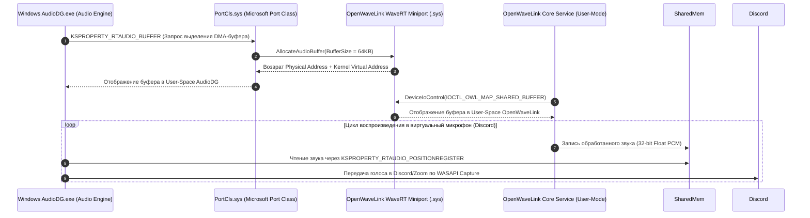

# Руководство по практической реализации OpenWaveLink на базе открытого кода

## 1. Введение и архитектурная стратегия

Проект **OpenWaveLink** разрабатывается как бескомпромиссная открытая замена Elgato Wave Link для Windows 11. Чтобы создать высокопроизводительный цифровой микшер без юридических рисков и нарушения авторских прав Elgato (чья кодовая база закрыта и защищена EULA), разработка опирается на проверенные открытые репозитории с лицензиями MIT, BSD и MS-PL.

Аудиоархитектура OpenWaveLink разделена на два фундаментальных контура:

1. **Входной контур (Input Ingestion) — 100% User-Mode (Zero-Driver):**
   Захват аудиопотоков запущенных игр, Discord, браузеров и медиаплееров реализуется без виртуальных аудиокабелей через нативный Windows 11 CoreAudio **Process Loopback API**. За основу взяты архитектурные решения проектов **`bozbez/win-capture-audio`** и его модернизированного форка **`Ayrton09/win-capture-audio`**.
2. **Выходной контур (Output Ingestion) — WDM WaveRT Драйвер Ядра (Вариант Б):**
   Предоставление системе виртуальных микрофонов для Discord, Zoom и OBS Studio (Stream Mix, MicFX) реализуется через открытый драйвер ядра WDM WaveRT на базе **Microsoft Sysvad (SimpleAudioSample)** и **`Virtual-Audio-Driver` (MIT) от MikeTheTech**.

```mermaid
graph TD
    subgraph Inputs["Входной контур (User-Mode Loopback)"]
        GameProc["Игровые процессы (PID)"]
        BrowserProc["Браузеры / Медиа (PID)"]
        WCA["Ядро захвата (на базе win-capture-audio / Ayrton09)"]
        LoopbackAPI["ActivateAudioInterfaceAsync + AUDIOCLIENT_PROCESS_LOOPBACK_PARAMS"]
        GameProc & BrowserProc --> LoopbackAPI
        LoopbackAPI --> WCA
    end

    subgraph CoreEngine["OpenWaveLink Engine (Real-Time Audio Core)"]
        MMCSS_Thread["MMCSS 'Pro Audio' RT Worker Thread"]
        RingBuffers["Lock-Free SPSC Ring Buffers"]
        RoutingMatrix["32-bit Float Matrix (8 In x 5 Out)"]
        DSP_Chain["OpenClipguard 2.0 + VST3 Chain + PDC"]
        WCA --> RingBuffers
        RingBuffers --> RoutingMatrix
        RoutingMatrix --> DSP_Chain
        MMCSS_Thread -.->|Высокий приоритет RT| CoreEngine
    end

    subgraph PolicyControl["Контроль маршрутизации Windows 11"]
        EarTrumpet["EarTrumpet Engine (IAudioPolicyConfigFactory)"]
        Win11_AudioSrv["Windows Audio Service (AudioSrv)"]
        EarTrumpet -->|SetPersistedDefaultAudioEndpoint| Win11_AudioSrv
    end

    subgraph Outputs["Выходной контур (Kernel WaveRT Driver - Вариант Б)"]
        WaveRT_Driver["OpenWaveLink WDM WaveRT Driver (MikeTheTech MIT)"]
        SharedMem["Shared Memory DMA Cyclic Buffer (KSPROPERTY_RTAUDIO_BUFFER)"]
        DiscordMic["Virtual Mic: OpenWaveLink MicFX"]
        StreamMix["Virtual Mic: OpenWaveLink Stream Mix"]
        DSP_Chain --> SharedMem
        SharedMem --> WaveRT_Driver
        WaveRT_Driver --> DiscordMic & StreamMix
    end
```

---

## 2. Глубокий анализ проектов bozbez/win-capture-audio и Ayrton09

Плагин `win-capture-audio` (автор *bozbez*, модернизированный форк *Ayrton09*) является эталонной реализацией внутрипроцессного захвата звука под Windows 11. Анализ кодовой базы выявляет ключевые архитектурные паттерны, необходимые для OpenWaveLink.

### 2.1. Механизм ActivateAudioInterfaceAsync и параметры активации

Активация аудиоинтерфейса выполняется асинхронно через COM API `ActivateAudioInterfaceAsync`. В Windows 11 передаётся специализированная структура параметров `AUDIOCLIENT_ACTIVATION_PARAMS`:

```cpp
#include <windows.h>
#include <mmdeviceapi.h>
#include <audioclient.h>
#include <audioclientactivationparams.h>
#include <wrl/client.h>
#include <wrl/implements.h>

using Microsoft::WRL::ComPtr;
using Microsoft::WRL::RuntimeClass;
using Microsoft::WRL::RuntimeClassFlags;
using Microsoft::WRL::ClassicCom;
using Microsoft::WRL::FtmBase;

// Обязательная реализация IAgileObject и FtmBase для предотвращения DEADLOCK
// при межпоточных маршалингах из MTA/STA подсистемы Windows Audio
class CaptureActivationHandler : public RuntimeClass<RuntimeClassFlags<ClassicCom>, 
                                                     IActivateAudioInterfaceCompletionHandler, 
                                                     FtmBase> 
{
public:
    explicit CaptureActivationHandler(HANDLE hCompletedEvent) 
        : completion_event_(hCompletedEvent), hr_result_(E_FAIL) {}

    STDMETHOD(ActivateCompleted)(IActivateAudioInterfaceAsyncOperation* asyncOp) override {
        ComPtr<IUnknown> unk;
        HRESULT hr = asyncOp->GetActivateResult(&hr_result_, &unk);
        if (SUCCEEDED(hr) && SUCCEEDED(hr_result_)) {
            hr_result_ = unk.As(&audio_client_);
        }
        SetEvent(completion_event_);
        return S_OK;
    }

    HRESULT GetClient(ComPtr<IAudioClient>& client) {
        if (SUCCEEDED(hr_result_)) client = audio_client_;
        return hr_result_;
    }

private:
    HANDLE completion_event_;
    HRESULT hr_result_;
    ComPtr<IAudioClient> audio_client_;
};
```

#### Режимы захвата: Include Tree vs Exclude Mode
Форк `Ayrton09` демонстрирует поддержку двух критически важных режимов перечисления `PROCESS_LOOPBACK_MODE`:

1. **Include Mode (`PROCESS_LOOPBACK_MODE_INCLUDE_TARGET_PROCESS_TREE`):**
   Захватывает аудиопоток целевого процесса и всех его дочерних потоков/подпроцессов. Это критично для современных игр с многопроцессной архитектурой (например, лаунчеры игр, звуковые движки Wwise/FMOD, вынесенные в отдельный PID).
2. **Exclude Mode (`PROCESS_LOOPBACK_MODE_EXCLUDE_TARGET_PROCESS_TREE`):**
   Захватывает **весь системный звук Windows 11 за исключением** указанного процесса. Это даёт OpenWaveLink возможность организовать канал «Desktop Audio minus Discord» или «Desktop Audio minus Spotify» без маршрутизации всех программ по отдельности.

```cpp
HRESULT CreateProcessLoopbackClient(DWORD targetPid, bool excludeMode, ComPtr<IAudioClient>& outClient) {
    HANDLE hEvent = CreateEvent(nullptr, FALSE, FALSE, nullptr);
    auto handler = Microsoft::WRL::Make<CaptureActivationHandler>(hEvent);

    AUDIOCLIENT_ACTIVATION_PARAMS params = {};
    params.ActivationType = AUDIOCLIENT_ACTIVATION_TYPE_PROCESS_LOOPBACK;
    params.ProcessLoopbackParams.TargetProcessId = targetPid;
    
    // Выбор режима включения/исключения дерева процессов
    params.ProcessLoopbackParams.ProcessLoopbackMode = excludeMode 
        ? PROCESS_LOOPBACK_MODE_EXCLUDE_TARGET_PROCESS_TREE
        : PROCESS_LOOPBACK_MODE_INCLUDE_TARGET_PROCESS_TREE;

    PROPVARIANT propVar = {};
    propVar.vt = VT_BLOB;
    propVar.blob.cbSize = sizeof(params);
    propVar.blob.pBlobData = reinterpret_cast<BYTE*>(&params);

    ComPtr<IActivateAudioInterfaceAsyncOperation> asyncOp;
    HRESULT hr = ActivateAudioInterfaceAsync(
        VIRTUAL_AUDIO_DEVICE_PROCESS_LOOPBACK,
        __uuidof(IAudioClient),
        &propVar,
        handler.Get(),
        &asyncOp
    );

    if (FAILED(hr)) {
        CloseHandle(hEvent);
        return hr;
    }

    WaitForSingleObject(hEvent, 3000);
    CloseHandle(hEvent);

    return handler->GetClient(outClient);
}
```

### 2.2. Выживание при перезапуске приложений (Survives Application Restart)

Главный недостаток встроенного захвата OBS — потеря захвата при перезапуске игры (смерть окна приводит к завершению аудиосессии). В форке `Ayrton09` эта проблема решена через **отслеживание по имени исполняемого файла (.exe) и подписку на события аудиосессий**:

1. Пользователь выбирает не конкретный `HWND` или `PID`, а имя бинарника (например, `cs2.exe` или `Discord.exe`).
2. Монитор сессий регистрирует слушатель `IAudioSessionNotification` на стандартном аудиоустройстве через `IAudioSessionManager2`.
3. При старте нового процесса вызывается метод `OnSessionCreated(IAudioSessionControl* NewSession)`.
4. Движок запрашивает `IAudioSessionControl2`, считывает `GetProcessId(&pid)` и сопоставляет его с именем процесса через `QueryFullProcessImageNameW`.
5. Если имя совпадает с правилом фильтрации, автоматически создаётся новый экземпляр `ProcessAudioCapturer` для нового PID, и захват восстанавливается бесшовно без вмешательства пользователя!

```cpp
class ProcessLifecycleWatcher : public RuntimeClass<RuntimeClassFlags<ClassicCom>, 
                                                     IAudioSessionNotification>
{
public:
    STDMETHODIMP OnSessionCreated(IAudioSessionControl* newSession) override {
        ComPtr<IAudioSessionControl2> session2;
        if (FAILED(newSession->QueryInterface(IID_PPV_ARGS(&session2)))) return S_OK;

        DWORD pid = 0;
        if (FAILED(session2->GetProcessId(&pid)) || pid == 0) return S_OK;

        HANDLE hProcess = OpenProcess(PROCESS_QUERY_LIMITED_INFORMATION, FALSE, pid);
        if (!hProcess) return S_OK;

        WCHAR imagePath[MAX_PATH] = {};
        DWORD pathSize = MAX_PATH;
        if (QueryFullProcessImageNameW(hProcess, 0, imagePath, &pathSize)) {
            std::wstring exeName = GetFileNameFromPath(imagePath);
            
            // Проверка по списку правил OpenWaveLink (например, привязка "cs2.exe" к каналу "Game")
            OnMatchedProcessStarted(exeName, pid);
        }

        CloseHandle(hProcess);
        return S_OK;
    }
};
```

### 2.3. Захват нескольких процессов (Multi-process mixing) и синхронизация времени
В одном софтверном канале OpenWaveLink может находиться произвольное число приложений (например, в канале «Game» одновременно активны `game.exe`, `steam.exe` и `anticheat.exe`).
- Для каждого активного PID создаётся независимый поток/воркер `IAudioCaptureClient`.
- Сэмплы извлекаются с точной временной меткой Windows QPC (`QueryPerformanceCounter`).
- Внутри канала работает легковесный сумматор, приводящий все потоки к единой частоте 48 кГц и суммирующий сэмплы в 32-bit Float буфер канала до подачи в VST3-инсерты.

---

## 3. Архитектура открытого WDM WaveRT драйвера (Вариант Б)

Для вывода финальных миксов в сторонние программы (виртуальный микрофон для Discord/Zoom/Skype) необходим нативный драйвер ядра Windows.

### 3.1. Анализ Microsoft Sysvad (SimpleAudioSample) и MikeTheTech Virtual-Audio-Driver
Проект **Virtual-Audio-Driver** от MikeTheTech (лицензия **MIT**) базируется на эталонном образце Microsoft WDK **SimpleAudioSample**:
- **Порт-минипорт архитектура (PortCls):** Драйвер реализует минипорты `IMiniportWaveRT` и `IMiniportTopology`. Системный драйвер Microsoft `PortCls.sys` берет на себя всю рутину интеграции с ядром Windows.
- **WaveRT (Wave Real-Time):** В отличие от старых версий (WaveCyclic), WaveRT выделяет непрерывный циклический DMA-буфер. Звуковая подсистема Windows (`AudioDG.exe`) и драйвер читают/пишут в один регион физической памяти без дорогостоящих прерываний ввода-вывода (Zero IRP Overhead).



### 3.2. Ключевые структуры WaveRT в коде драйвера

#### Регистрация пинов рендеринга и захвата (Pin Descriptors)
Драйвер регистрирует две фабрики пинов:
1. `PIN_WAVERT_RENDER`: конечная точка динамиков (для виртуальных кабелей ввода).
2. `PIN_WAVERT_CAPTURE`: конечная точка микрофона (для вывода миксов OpenWaveLink).

```cpp
// Дескриптор пина микрофона (WaveRT Capture Pin)
static KSPIN_DISPATCH WaveRTPinDispatch = {
    PinCreate,
    PinClose,
    PinProcess,
    PinReset,
    PinSetDataFormat,
    PinSetDeviceState,
    NULL,
    NULL,
    NULL,
    NULL
};

static PCPIN_DESCRIPTOR MiniportPins[] = {
    // Pin 0: KSPIN_DATAFLOW_OUT (Capture Endpoint для Discord / OBS)
    {
        0, 0, 0,
        NULL,
        {
            0, NULL,
            0, NULL,
            SIZEOF_ARRAY(PinDataRangePointers),
            PinDataRangePointers,
            KSPIN_DATAFLOW_OUT,
            KSPIN_COMMUNICATION_SINK,
            &KSCATEGORY_AUDIO,
            NULL,
            0
        }
    }
};
```

#### Обработка свойств циклического буфера KSPROPERTY_RTAUDIO_BUFFER
```cpp
NTSTATUS PropertyHandler_RtAudioBuffer(PPCPROPERTY_REQUEST PropertyRequest) {
    auto* stream = reinterpret_cast<CMiniportWaveRTStream*>(PropertyRequest->MajorTarget);
    
    if (PropertyRequest->Verb & KSPROPERTY_TYPE_GET) {
        auto* bufferParams = reinterpret_cast<PKSRTAUDIO_BUFFER_PROPERTY>(PropertyRequest->Property);
        auto* bufferDescription = reinterpret_cast<PKSRTAUDIO_BUFFER>(PropertyRequest->Value);

        // Выделение циклического буфера памяти ядра
        PMDL pMdl = nullptr;
        PVOID pKernelAddress = nullptr;
        ULONG actualSize = 0;

        NTSTATUS ntStatus = stream->AllocateBuffer(
            bufferParams->RequestedBufferSize,
            &pMdl,
            &pKernelAddress,
            &actualSize
        );

        if (NT_SUCCESS(ntStatus)) {
            bufferDescription->BufferAddress = pKernelAddress;
            bufferDescription->ActualBufferSize = actualSize;
            bufferDescription->Flags = 0;
            PropertyRequest->ValueSize = sizeof(KSRTAUDIO_BUFFER);
        }
        return ntStatus;
    }
    return STATUS_INVALID_DEVICE_REQUEST;
}
```

---

## 4. Обоснование выбора Варианта Б над Вариантом А и отказ от Варианта В

| Критерий оценки | Вариант А: Эмуляция USB Audio (USB/IP + `usbaudio.sys`) | Вариант Б (ВЫБРАН): WDM WaveRT (Sysvad / MikeTheTech MIT) | Вариант В: Драйверы Steam Streaming Audio |
| :--- | :--- | :--- | :--- |
| **Принцип работы** | Создание виртуальной шины USB через протокол USB/IP; ядро подгружает стандартный `usbaudio.sys`. | Нативный аудиоминипорт ядра Windows 11 с кольцевым DMA-буфером в системной памяти. | Использование чужих драйверов `Steam Streaming Speakers/Mic` от клиента Steam. |
| **Сквозная задержка** | **Высокая (5–12 мс)** из-за упаковки в изохронные URB-пакеты шины USB. | **Минимальная (< 1 мс)** благодаря прямому отображению памяти `AudioDG.exe`. | Непредсказуемая, оптимизирована под удалённый стриминг экрана. |
| **Стабильность при сбое GUI** | **Критическая уязвимость**: падение GUI отключает USB/IP шину $\to$ Windows играет звук отключения USB и сбрасывает микрофон в Discord. | **Идеальная отказоустойчивость**: драйвер ядра изолирован. Перезапуск UI OpenWaveLink **не прерывает** поток звука. | Зависит от обновлений Steam; удаление Steam ломает звук во всей системе. |
| **Брендирование в Windows 11** | Ограничено дескрипторами USB, сложно задавать пользовательские имена каналов на лету. | **100% нативные имена в INF**: «OpenWaveLink MicFX», «OpenWaveLink Stream Mix». | Устройства всегда называются «Steam Streaming...», переименование невозможно. |
| **Лицензионная чистота** | Требует драйвера эмулятора USB/IP (часто GPL). | **100% MIT / MS-PL**: абсолютно чистая лицензия для открытого коммерческого и некоммерческого ПО. | **Грубое нарушение**: использование проприетарных драйверов Valve вне клиента Steam. |
| **Вердикт** | ⚠️ Запасной вариант при невозможности подписи. | ✅ **ЕДИНСТВЕННО ВЕРНЫЙ ВЫБОР ДЛЯ OPENWAVELINK**. | ❌ **КАТЕГОРИЧЕСКИ ОТКЛОНЁН (БРЕД)**. |

---

## 5. Взаимодействие с COM-интерфейсом IAudioPolicyConfig (Опыт EarTrumpet)

В Windows 11 перенаправление вывода конкретных программ на определенные звуковые карты спрятано в `Параметры -> Звук -> Громкость приложений и настройки устройств`. Чтобы OpenWaveLink мог в один клик направлять, например, Spotify на софтверный виртуальный канал `OpenWaveLink Music`, используется недокументированный внутренний COM-интерфейс Windows **`IAudioPolicyConfigFactory`** (исследованный и проверенный разработчиками популярного приложения **EarTrumpet**).

### 5.1. Определение интерфейса и IID для Windows 11

```cpp
#include <windows.h>
#include <mmdeviceapi.h>

// Недокументированный GUID фабрики AudioPolicyConfig в Windows 10/11
// CLSID: {2a59116d-6c4f-45e0-a74f-707e3fef9258}
static const IID CLSID_AudioPolicyConfigFactory = 
    { 0x2a59116d, 0x6c4f, 0x45e0, { 0xa7, 0x4f, 0x70, 0x7e, 0x3f, 0xef, 0x92, 0x58 } };

// IID_IAudioPolicyConfigFactory: {ab21acdc-e190-4c3e-865b-61014cc6793e}
MIDL_INTERFACE("ab21acdc-e190-4c3e-865b-61014cc6793e")
IAudioPolicyConfigFactory : public IUnknown
{
public:
    virtual HRESULT STDMETHODCALLTYPE __placeholder1() = 0;
    virtual HRESULT STDMETHODCALLTYPE __placeholder2() = 0;
    virtual HRESULT STDMETHODCALLTYPE __placeholder3() = 0;
    virtual HRESULT STDMETHODCALLTYPE __placeholder4() = 0;

    // Ключевой метод: установка постоянного аудиоустройства для конкретного процесса
    virtual HRESULT STDMETHODCALLTYPE SetPersistedDefaultAudioEndpoint(
        DWORD processId,
        EDataFlow flow,          // eRender (воспроизведение) или eCapture (запись)
        ERole role,              // eConsole, eMultimedia, eCommunications
        LPCWSTR endpointDeviceId // Идентификатор IMMDevice (например, ID устройства OpenWaveLink Music)
    ) = 0;

    virtual HRESULT STDMETHODCALLTYPE ClearAllPersistedApplicationDefaultEndpoints() = 0;
};
```

### 5.2. Практическая реализация перенаправления процесса

```cpp
HRESULT RouteApplicationToVirtualChannel(DWORD processId, LPCWSTR openWaveLinkDeviceEndpointId) {
    ComPtr<IAudioPolicyConfigFactory> policyConfig;
    HRESULT hr = CoCreateInstance(
        CLSID_AudioPolicyConfigFactory,
        nullptr,
        CLSCTX_INPROC_SERVER,
        IID_PPV_ARGS(&policyConfig)
    );

    if (FAILED(hr)) return hr;

    // Мгновенное перенаправление воспроизведения процесса на устройство OpenWaveLink
    hr = policyConfig->SetPersistedDefaultAudioEndpoint(
        processId,
        eRender,
        eMultimedia,
        openWaveLinkDeviceEndpointId
    );

    if (SUCCEEDED(hr)) {
        // Дублируем для роли eConsole
        policyConfig->SetPersistedDefaultAudioEndpoint(
            processId,
            eRender,
            eConsole,
            openWaveLinkDeviceEndpointId
        );
    }

    return hr;
}
```

---

## 6. Практическая настройка Windows MMCSS (Pro Audio)

Для гарантированного исключения аудиощелчков (Buffer Underrun / Glitches) при 100% нагрузке на процессор в играх поток обработки OpenWaveLink регистрируется в **Multimedia Class Scheduler Service (MMCSS)**.

### 6.1. Регистрация рабочего потока реального времени

```cpp
#include <avrt.h>
#pragma comment(lib, "avrt.lib")

void SetupAudioThreadRealtimePriority() {
    // 1. Повышение приоритета потока ОС до максимума
    SetThreadPriority(GetCurrentThread(), THREAD_PRIORITY_TIME_CRITICAL);

    // 2. Регистрация в задаче "Pro Audio" MMCSS Windows 11
    DWORD taskIndex = 0;
    HANDLE hMmcss = AvSetMmThreadCharacteristicsW(L"Pro Audio", &taskIndex);
    
    if (!hMmcss) {
        // Запасной профиль при отсутствии прав на Pro Audio
        hMmcss = AvSetMmThreadCharacteristicsW(L"Audio", &taskIndex);
    }

    if (hMmcss) {
        // Установка наивысшего приоритета выполнения внутри группы задач MMCSS
        AvSetMmThreadPriority(hMmcss, AVRT_PRIORITY_CRITICAL);
    }
}
```

### 6.2. Реестровые параметры MMCSS для Pro Audio в Windows 11
При установке OpenWaveLink инсталлятор оптимизирует системные параметры MMCSS в реестре Windows 11:
- Путь реестра: `HKLM\SOFTWARE\Microsoft\Windows NT\CurrentVersion\Multimedia\SystemProfile`
  - `SystemResponsiveness`: `DWORD = 0` (выделяет до 100% квантов процессора мультимедийным задачам реального времени вместо резервирования 20% под фоновые процессы).
- Путь реестра задач: `HKLM\SOFTWARE\Microsoft\Windows NT\CurrentVersion\Multimedia\SystemProfile\Tasks\Pro Audio`
  - `Scheduling Category`: `REG_SZ = "High"`
  - `Priority`: `DWORD = 24` (Real-Time диапазон)
  - `Clock Rate`: `DWORD = 10000` (тактовая частота таймера планировщика 1 мс).

### 6.3. Жёсткие правила для Audio Real-Time Thread:
Внутри потока микширования и DSP OpenWaveLink **категорически запрещены**:
1. Любые вызовы динамического выделения памяти (`malloc`, `new`, `realloc`, `HeapAlloc`). Вся память под кольцевые буферы и сэмплы предвыделяется при инициализации.
2. Блокирующие примитивы синхронизации (`std::mutex`, `EnterCriticalSection`, `Sleep`). Обмен данными между GUI и аудиоядром осуществляется исключительно через атомарные безблокировочные структуры **Lock-Free SPSC Ring Buffer**.
3. Файловый ввод-вывод и сетевые операции (`printf`, логирование в файл, сокеты).
